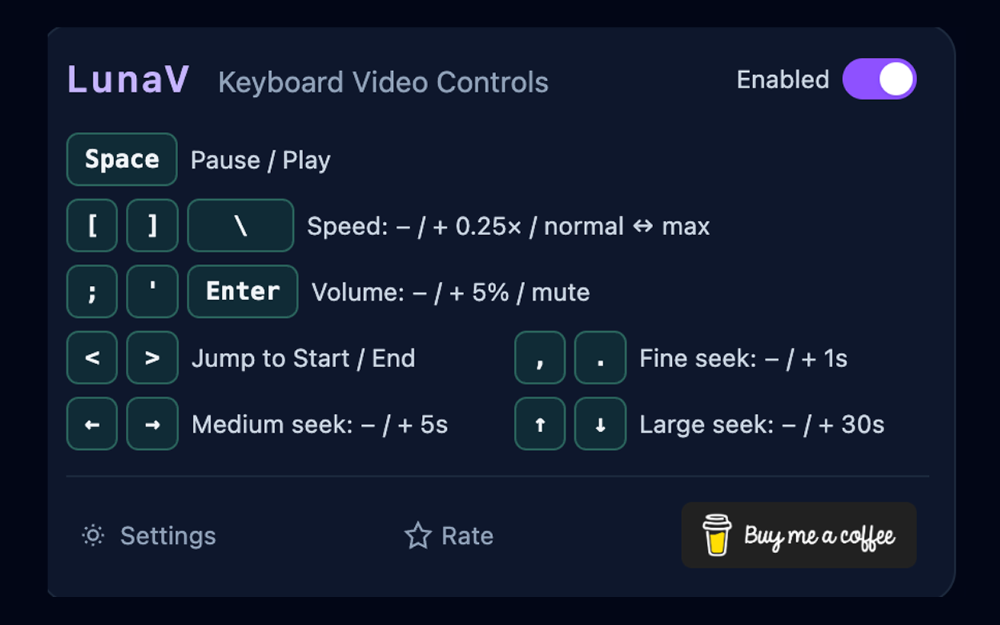
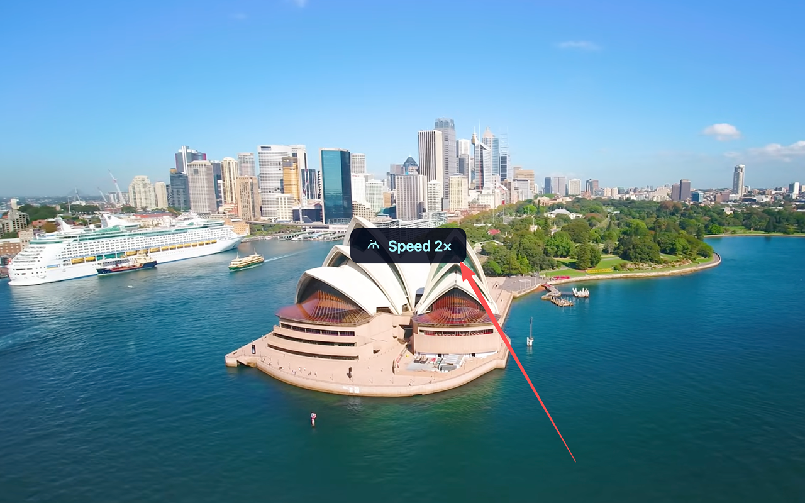
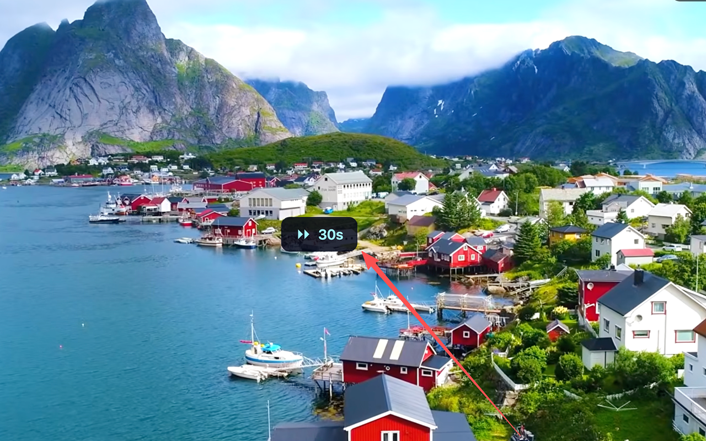

# LunaV — Keyboard Video Controls

LunaV is a lightweight Chrome extension that lets you control HTML5 videos with customisable keyboard shortcuts for playback, speed, volume, and precise seeking.

[](https://chromewebstore.google.com/detail/keyboard-video-controls-l/bnigppeaeiopniiknljifpkgjmkcfgkf)
[](LICENSE)

## Install

Install LunaV directly from the [Chrome Web Store](https://chromewebstore.google.com/detail/keyboard-video-controls-l/bnigppeaeiopniiknljifpkgjmkcfgkf).

---

## Screenshots

<div align="center">
  
  <p><em>LunaV quick-access popup with instant shortcut reference and global extension toggle.</em></p>
</div>

<br />

<div align="center">
  
  &nbsp;
  
  <p><em>Minimalist on-screen display (OSD) provides instant visual feedback for speed adjustments and timeline seeks without interrupting playback.</em></p>
</div>

---

## Key Features

- **Intuitive Playback Control**: Toggle play/pause instantly on active videos without reaching for the mouse.
- **Granular Speed Control**: Adjust playback speed in configurable increments (default 0.25×) or toggle between normal (1×) and maximum speed with a single key.
- **Three-Tier Precise Seeking**: Navigate timelines with sub-second fine seeking (default 1s), standard medium skips (default 5s), or large leaps (default 30s), plus instant jumps to video start or end.
- **Volume & Mute Control**: Adjust volume in smooth increments (default 5%) or toggle mute with automatic volume restoration.
- **Customisable Settings**: Adjust seek durations, speed increments and boundaries, and volume step size via the dedicated extension options page.
- **Clean In-Page HUD**: Non-intrusive on-screen overlay communicates current playback speed, seek distance, and volume levels.
- **Smart Video Targeting**: Automatically identifies the primary video on the page using visibility, focus, and viewport-distance heuristics.
- **Platform Compatibility**: Designed for standard HTML5 `<video>` elements across the web, with dedicated adapters for platforms like Echo360 (supporting discrete menu speeds and leader video targeting) and Netflix (integrating with Cadmium player seeking).
- **Privacy First**: Runs locally in your browser with zero analytics, no telemetry, and no external tracking.

---

## Keyboard Shortcuts

The following default shortcuts are active whenever an HTML5 video is present and the user is not focused on a text input, textarea, or editable element:

| Key | Action | Default Increment / Target | Configurable in Settings |
| :--- | :--- | :--- | :---: |
| <kbd>Space</kbd> | Play / Pause | Toggle playback state | — |
| <kbd>[</kbd> | Decrease playback speed | −0.25× (min 0.25×) | Yes (step & min) |
| <kbd>]</kbd> | Increase playback speed | +0.25× (max 5×) | Yes (step & max) |
| <kbd>\</kbd> | Toggle speed | Toggle between 1× and max speed | Yes (via max speed) |
| <kbd>;</kbd> | Decrease volume | −5% | Yes (step) |
| <kbd>'</kbd> | Increase volume | +5% | Yes (step) |
| <kbd>Enter</kbd> | Mute / Unmute | Toggle mute (restores previous volume) | — |
| <kbd>&lt;</kbd> | Jump to start | Beginning of video (0s) | — |
| <kbd>&gt;</kbd> | Jump to end | End of video | — |
| <kbd>,</kbd> | Fine seek backward | −1 second | Yes (duration) |
| <kbd>.</kbd> | Fine seek forward | +1 second | Yes (duration) |
| <kbd>←</kbd> | Medium seek backward | −5 seconds | Yes (duration) |
| <kbd>→</kbd> | Medium seek forward | +5 seconds | Yes (duration) |
| <kbd>↑</kbd> | Large seek backward | −30 seconds | Yes (duration) |
| <kbd>↓</kbd> | Large seek forward | +30 seconds | Yes (duration) |

> [!NOTE]
> The backslash (<kbd>\</kbd>) key toggles between normal speed (1×) and your configured maximum speed (default 5×). If the video is currently at 1×, pressing <kbd>\</kbd> jumps straight to maximum speed; pressing it at any other rate returns speed to 1×.

---

## Tech Stack

LunaV is built with modern web extension technologies:

- **Framework**: [WXT](https://wxt.dev/) (Next-gen Web Extension Framework) targeting Manifest V3
- **UI**: [React 19](https://react.dev/)
- **Styling**: [Tailwind CSS v4](https://tailwindcss.com/)
- **Language**: [TypeScript](https://www.typescriptlang.org/)
- **Bundler**: [Vite](https://vitejs.dev/)
- **Package Manager**: [pnpm](https://pnpm.io/)

---

## Development

### Prerequisites

- Node.js (v18+)
- [pnpm](https://pnpm.io/) (v10+ recommended)

### Setup & Build

Clone the repository and install dependencies:

```bash
git clone https://github.com/Leo7805/luna-v.git
cd luna-v
pnpm install
```

Start the local development server with hot module reloading:

```bash
pnpm dev
```

Run type checks:

```bash
pnpm compile
```

Build the production extension bundle:

```bash
pnpm build
```

The compiled extension will be output to `.output/chrome-mv3/`. You can load this directory as an unpacked extension in Chrome via `chrome://extensions` (with Developer mode enabled).

---

## Privacy & Security

LunaV operates entirely client-side, requiring only the standard Chrome `storage` permission to persist user preferences. It does not collect, log, or transmit any user data or browsing activity.

For more details, see the [Privacy Policy](PRIVACY.md).

---

## License

This project is licensed under the MIT License. See [LICENSE](LICENSE) for details.
